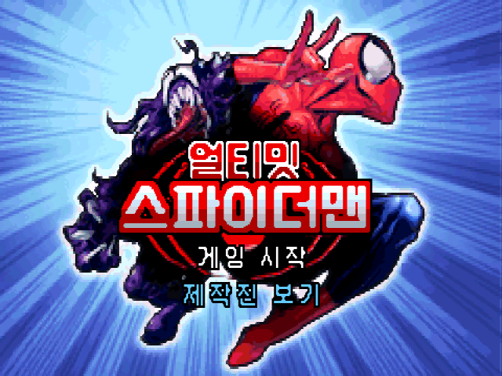
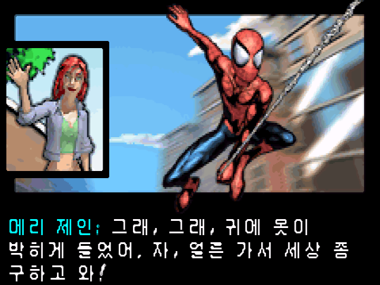
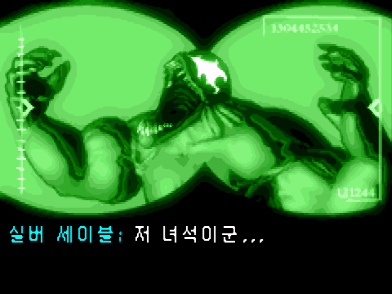
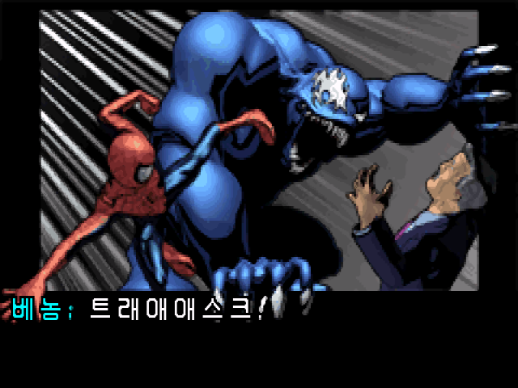

# 얼티밋 스파이더맨 (GBA, 북미판) 한글패치

팬이 만든 한국어 번역 패치입니다. **게임 롬은 들어 있지 않습니다.** 가지고 있는 원본 롬에 패치를 적용해서 쓰세요.



**[⬇ 최신판 받기 (v1.0)](https://github.com/msungaffa/usm-gba-kr/releases/latest)** — `USM_GBA_KR_v1.0.xdelta` (패치), `README.txt` (설명서)

| | | |
|---|---|---|
|  |  |  |

## 대상 원본

Ultimate Spider-Man (USA) — 게임보이 어드밴스, 게임 코드 BULE (No-Intro 덤프와 같음)

| 항목 | 값 |
|---|---|
| 파일 이름 예 | `Ultimate Spider-Man (USA).gba` |
| 크기 | 16,777,216 바이트 (16MB) |
| CRC32 | `931E2C18` |
| MD5 | `11beb7fd8ce6c8a3d4987274835e0843` |
| SHA-1 | `1f5959b66dafb33c9fa01389c23214b38b0fcc79` |

- 유럽판(BULP·BULX)이나 다른 덤프에는 적용되지 않습니다. 해시가 다르면 패치가 안 되거나 깨진 롬이 나올 수 있습니다.
- GBA 롬에는 헤더가 없습니다. 패처의 «헤더 추가/제거» 옵션은 끈 채로 두세요.
- BIOS 파일이 없어도 됩니다.

## 적용법

- **웹 (PC·안드로이드·아이폰)**: [Rom Patcher JS](https://www.marcrobledo.com/RomPatcher.js/)에서 «ROM file»에 원본 롬, «Patch file»에 `USM_GBA_KR_v1.0.xdelta`를 넣고 «Apply patch».
- **PC**: xdelta UI, Delta Patcher, 또는 명령줄
  ```
  xdelta3 -d -s "Ultimate Spider-Man (USA).gba" USM_GBA_KR_v1.0.xdelta "Ultimate Spider-Man (KR).gba"
  ```

## 결과 롬 해시 (적용 후 이 값과 같아야 정상)

| 항목 | 값 |
|---|---|
| CRC32 | `CF39D0DB` |
| MD5 | `75ebe05f9a84f8044026fbc3775679d3` |
| SHA-1 | `f72ce6cffb662da115432d7c7f20e8d6c86426e6` |

결과 롬 크기는 원본과 같습니다(16MB).

## 번역 범위

- **번역함**: 대사·컷신, 튜토리얼 안내, 메뉴 문구 등 게임 안 문장 365줄, 타이틀 로고
- **원문 유지**: 엔딩 크레딧, 타이틀 직전 애니메이션에서 로고가 날아오는 앞부분, 그 밖의 그림으로 된 글자, 북미판 화면에 나오지 않는 언어 이름 목록
- 고유명사는 마블 국내 정식 표기(영화·정발 코믹스)를 기준으로 삼았습니다.

## 세이브

- 세이브 형식(EEPROM)은 바꾸지 않았습니다.
- 에뮬은 보통 롬 파일 이름으로 세이브를 찾습니다. 롬 이름을 바꾸면 세이브도 같은 이름으로 바꿔 주세요.
- 세이브스테이트(상태 저장)는 버전 사이에 호환되지 않습니다. 게임 안에서 저장한 세이브로 이어 하세요.

## 확인한 환경

| 환경 | 확인 내용 |
|---|---|
| mGBA 0.10.5 (Windows) | 콜드 부팅, 실제 플레이, 전 대사 강제 표시 검수(깨짐·누락·넘침 0) |
| RetroArch 1.22.2 + mGBA 코어 (BIOS 있음/없음) | 콜드 부팅 → 한글 타이틀, 게임 안 저장·불러오기 |
| RetroArch 1.22.2 + gpSP 코어 (BIOS 있음/없음) | 콜드 부팅 → 한글 타이틀, 게임 안 저장·불러오기 |
| muOS 휴대용 기기 | 실제 플레이 |
| GBA 실기·플래시카트 | 확인하지 못했습니다. 해 보신 분은 [Issues](https://github.com/msungaffa/usm-gba-kr/issues)로 알려 주세요. |

버그나 오타는 [Issues](https://github.com/msungaffa/usm-gba-kr/issues)에 버전·에뮬·장면을 적어 주세요.

## 변경 이력

- **v1.0** (2026-10-27): 첫 판 — 대사·메뉴 한글화, 타이틀 로고 한글화

---

비영리 팬 번역입니다. Ultimate Spider-Man의 권리는 Marvel, Activision, Vicarious Visions에 있습니다. 롬 파일은 배포하지 않으며, 롬 요청에는 답하지 않습니다.
